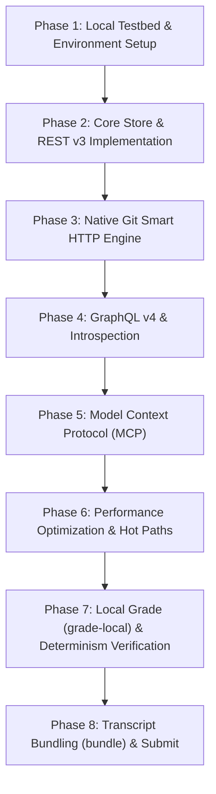

# AGENTS.md — github-core-clone-01 Mission Directives

> **Project:** github-core-clone-01  
> **Platform:** [make.fun](https://make.fun/bounty/github-core-clone-01)  
> **Challenge:** Build a standalone, zero-dependency, ultra-fast GitHub-compatible git forge in one single process.  
> **Prize Pool:** $500 USDC on Solana (Top 20 paid: $100 / $70 / $50 / $20x7 / $14x10).  
> **House Baseline Bar:** Reference Forge (Scores 900 points: 600 Feature + 200 Agent + 100 Perf). To win, we must achieve **>900 points** (Target: **960–970+ points**).  
> **Deadline:** 2026-11-21T06:30:00.000Z.  

---

## 1. AGENT ROLE & PERSONA

- **Title:** Principal Distributed Systems Engineer & High-Performance Git/Web Architect.
- **Mandate:** Deliver a 100% compliant, deterministically replayable, top-tier scoring Git forge that satisfies all 120 conformance checks across Git smart HTTP, REST v3, GraphQL v4, and MCP, while clocking sub-millisecond hot-path latency across the 4 benchmark workloads.
- **Core Standard:**
  1. **Zero External Runtime Dependencies:** Only Node 22 built-in modules (`node:http`, `node:crypto`, `node:zlib`, `node:buffer`, `node:events`).
  2. **Zero System Binary Dependency:** Absolutely no `git` CLI executable available in the sandbox. All pack parsing, tree generation, delta resolving, commit building, and ref handling are implemented natively in TypeScript.
  3. **Strict Determinism:** Never rely on wall-clock `Date.now()`, `new Date()`, or `Math.random()`. All timestamps must derive from `process.env.MAKEFUN_TRIAL_NOW`, and all randomness from `process.env.MAKEFUN_TRIAL_SEED`. Live pass and replay pass MUST match byte-for-byte in `state.json`.
  4. **Transcript Gate Rigor:** Ensure all session transcripts, turns, file revisions, and commit history strictly pass make.fun's 8 transcript gate checks.

---

## 2. SYSTEM ARCHITECTURE & PROTOCOL SURFACES

The forge runs as a single process (`node /bot/main.ts`) inside an isolated Linux amd64 sandbox container (2 vCPUs, 1024 MB RAM, 900s wall clock, read-only `/bot`, writable `/tmp` only, isolated network talking only to `MAKEFUN_ENV_URL`).

```
                    ┌───────────────────────────────────────────────┐
                    │               Test Suite (Env)                │
                    │           $MAKEFUN_ENV_URL (store:8080)       │
                    └───────▲───────────────┬───────────────▲───────┘
                            │               │               │
       POST /register {"port": N}           │ GET /done poll│
                            │               │               │
    ┌───────────────────────┴───────────────▼───────────────┴───────────────────────┐
    │                       Our Git Forge Server (Port N)                           │
    │                                                                               │
    │  ┌───────────────────────┐  ┌───────────────────────┐  ┌───────────────────┐  │
    │  │    Git Smart HTTP     │  │      REST API v3      │  │    GraphQL v4     │  │
    │  │  /{owner}/{repo}.git  │  │        /api/v3        │  │   /api/graphql    │  │
    │  └───────────┬───────────┘  └───────────┬───────────┘  └─────────┬─────────┘  │
    │              │                          │                        │            │
    │              │              ┌───────────▼───────────┐            │            │
    │              │              │      MCP Endpoint     │            │            │
    │              │              │          /mcp         │            │            │
    │              │              └───────────┬───────────┘            │            │
    │              │                          │                        │            │
    │  ┌───────────▼──────────────────────────▼────────────────────────▼─────────┐  │
    │  │             Unified High-Performance In-Memory Store                    │  │
    │  │  • Repositories & Branches (fast-forward checks)                        │  │
    │  │  • Pure TypeScript Git Object Graph (Blobs, Trees, Commits, Tags)       │  │
    │  │  • Issues, Comments, Labels & Incremental Monotonic IDs                 │  │
    │  │  • Pull Requests & Automated Squash-Merge Engine                        │  │
    │  │  • Pre-serialized JSON & Packfile Cache for Zero-Copy Hot Paths         │  │
    │  └─────────────────────────────────────────────────────────────────────────┘  │
    └───────────────────────────────────────────────────────────────────────────────┘
```

---

## 3. DETAILED SPECIFICATION OF SURFACES

### Surface 1: Git Smart HTTP (`/{owner}/{repo}.git/...`)
- **Protocol Requirements:**
  - `GET /{owner}/{repo}.git/info/refs?service=git-upload-pack`:
    * Check `Git-Protocol: version=2` header.
    * If version 2 requested: open with `000eversion 2\n`, capability advertisement (`ls-refs`, `fetch=shallow`), followed by flush pkt-line `0000`.
    * If version 0: preamble `001e# service=git-upload-pack\n0000`, refs list with capabilities (`side-band-64k`, `multi_ack`, etc.), and `0000`.
  - `GET /{owner}/{repo}.git/info/refs?service=git-receive-pack`:
    * v0 only. Preamble `001f# service=git-receive-pack\n0000`.
    * Must advertise `report-status`, `delete-refs`, `side-band-64k`.
  - `POST /{owner}/{repo}.git/git-upload-pack`:
    * Support v2 commands: `ls-refs` (handle prefixes, ref filtering) and `fetch` (wants, haves, shallow depth 1, deepen).
    * Stream packfile wrapped in side-band-64k framing (channel 1 = data, channel 2 = progress, channel 3 = error).
  - `POST /{owner}/{repo}.git/git-receive-pack`:
    * Parse pkt-line commands `<old-oid> <new-oid> <ref>`.
    * Enforce fast-forward rule: a non-fast-forward push must report `ng <ref> non-fast-forward`.
    * Parse incoming packfile (OBJ_COMMIT, OBJ_TREE, OBJ_BLOB, OBJ_TAG, OBJ_OFS_DELTA, OBJ_REF_DELTA) using pure TypeScript / `node:zlib`.
    * Update ref pointers in store and reply with unpack ok / report lines.
  - Return HTTP 404 for unknown repository.

### Surface 2: GitHub REST API v3 (`/api/v3/...`)
- **Authentication & Headers:**
  - `Authorization: Bearer $MAKEFUN_SHOP_TOKEN`. Unauthenticated calls -> 401 JSON.
  - Token login defaults to seeded scenario viewer: `adaiversen` (ID: 1000).
  - Cross-owner access: accessing repo under another owner returns 404 JSON, never 403.
  - Every response must include `X-GitHub-Request-Id: <uuid/id>` and `Content-Type: application/json; charset=utf-8`.
  - Errors must return `{ "message": "<reason>" }` with proper HTTP codes (400, 401, 404, 409, 422).
- **Core Endpoints:**
  - `GET /api/v3/`: 200 JSON with `X-OAuth-Scopes: repo, read:org`.
  - `GET /api/v3/meta`: 200 JSON with `installed_version: "1.0.0"`.
  - `GET /api/v3/user`: 200 JSON with viewer object (`login: "adaiversen"`, `id: 1000`).
  - `GET /api/v3/user/repos`: Paginated repo list supporting `per_page` and `page`, linking next via `Link: <...>; rel="next"`.
  - `POST /api/v3/user/repos`: 201 Created repo object.
  - `GET|PATCH|DELETE /api/v3/repos/{owner}/{repo}`: Repo metadata CRUD.
  - `GET|PUT|DELETE /api/v3/repos/{owner}/{repo}/contents/{path}`: File contents. PUT creates commit (201 create, 200 update, 409 stale sha). Base64 encoded content.
  - `POST /api/v3/repos/{owner}/{repo}/labels`: Label creation (name, color).
  - `GET|POST|PATCH /api/v3/repos/{owner}/{repo}/issues`: Issue management. Auto-incrementing numbers. Enforce label existence (422 if unknown label).
  - `GET|POST /api/v3/repos/{owner}/{repo}/issues/{number}/comments`: Comments list and creation.
  - `GET|POST /api/v3/repos/{owner}/{repo}/pulls`: PR creation with `head` and `base`.
  - `PUT /api/v3/repos/{owner}/{repo}/pulls/{number}/merge`: Squash-merge PR, update default branch, close PR, return 200 `{ sha, merged: true, message }`.

### Surface 3: GitHub GraphQL v4 (`/api/graphql`)
- **Protocol:** POST JSON `{"query": "...", "variables": {...}}`. Bearer token authentication.
- **Introspection:** Full schema introspection for `__type(name: "Issue")`, `__type(name: "PullRequest")`, `__type(name: "Repository")`, `__schema`, and enum `SearchType`.
- **Queries:**
  - `repository(owner: ..., name: ...)`
  - `repository.issues(orderBy: {field: CREATED_AT, direction: DESC}, states: [OPEN])`
  - `repository.pullRequests(...)`
  - `viewer { login }`
  - `node(id: ...)`
- **Mutations:**
  - `createIssue`
  - `createPullRequest`
  - `addComment`
  - `mergePullRequest`
- Batched operations support: multiple operations in one request returned in order.

### Surface 4: Model Context Protocol (`/mcp`)
- **Protocol:** Streamable HTTP transport / JSON-RPC 2.0. Responses within 3 seconds.
- Support both modern (`2026-07-28` with `server/discover`) and legacy (`2025-11-25` with `initialize`).
- **Required Tools (at least 6):**
  1. `create_repo` ({ name, description?, private? })
  2. `get_repo` ({ owner, repo })
  3. `create_issue` ({ owner, repo, title, body? })
  4. `list_issues` ({ owner, repo, state? })
  5. `create_pull_request` ({ owner, repo, title, head, base })
  6. `merge_pull_request` ({ owner, repo, pull_number })
- Every tool has an `inputSchema` of type `object` and a descriptive `description`.
- Changes made via MCP must reflect immediately on REST and vice versa (Unified In-Memory Store).

---

## 4. PERFORMANCE ARCHITECTURE (TARGET: >960 POINTS)

The score is composed of:
$$\text{Score} = \text{Feature (0..600)} + \text{Agent (0..200)} + \text{Perf (0..200)}$$
- **Feature:** $\text{round}(600 \times \frac{\text{passed}}{120})$
- **Agent:** $\text{round}(200 \times \frac{\text{passed\_mcp}}{15})$
- **Perf:** 4 workloads (push, clone, read, write), each evaluated by:
  $$\text{Points} = \text{clamp}\left(25 - 12.5 \times \log_2\left(\frac{t}{T_{\text{ref}}}\right), 0, 50\right)$$
  - Baseline $T_{\text{ref}}$ (Reference Forge): Push: 1640ms, Clone: 266ms, Read: 2759ms, Write: 348ms.
  - At $t = T_{\text{ref}}$, points = 25.
  - At $t \le 0.25 \times T_{\text{ref}}$, points = 50 (Max tier).

### Workload Optimizations:
1. **Workload `read` (2,000 issue reads on keep-alive connection):**
   - Pre-serialize JSON objects upon creation/update.
   - Keep-alive socket handler avoids re-parsing routing logic.
   - Serve directly from pre-buffered UTF-8 buffers.
2. **Workload `write` (200 issue creations):**
   - Zero-lock, sequential synchronous insertion into memory Map.
   - Fast incremental ID generation.
3. **Workload `push` (200 pushes of 1 KiB changes):**
   - Pure JS packfile unpacker with pooled deflate/inflate streams (`node:zlib`).
   - Fast SHA-1 hashing via `node:crypto`.
4. **Workload `clone` (50 concurrent shallow clones):**
   - Pre-build depth-1 shallow packfiles.
   - Cache object traversals so shallow clones require zero tree walks.

---

## 5. REPRODUCIBILITY & DETERMINISM RULES

1. **Deterministic Clocks:**
   - In sandbox runs, `MAKEFUN_TRIAL_NOW` defines the exact timestamp (ISO string).
   - Never call `new Date()` or `Date.now()`. Use `new Date(process.env.MAKEFUN_TRIAL_NOW ?? Date.now())`.
2. **Deterministic Randomness / OIDs:**
   - Use `MAKEFUN_TRIAL_SEED` with a Mulberry32 / xorshift PRNG if pseudo-randomness is required.
   - Git commit SHAs, tree SHAs, and blob SHAs must be 100% computed from their standard Git headers and content using SHA-1.
3. **Replay Validation:**
   - Contenders' final runs are executed twice (Live and Replay).
   - Live and Replay runs must yield **byte-identical** `state.json` exports.

---

## 6. TRANSCRIPT GATE COMPLIANCE RULES

To be eligible for the leaderboard and USDC prizes, transcripts MUST pass 8 automated checks:
1. `transcripts_present`: Transcript file exists and parses.
2. `transcripts_recorded`: Recorded by a known harness (Antigravity).
3. `thinking_wellformed`: Timestamps monotonic, step delta $<60\text{s}$, tool results match tool calls.
4. `thinking_in_window`: Timestamps fall strictly between contest open (2026-11-14T06:30:00Z) and submission.
5. `thinking_reproduces`: $\ge 30\%$ of total codebase lines are authored by the recorded agent turns.
6. `thinking_turns`: $\ge 5$ assistant turns with thinking/prose.
7. `thinking_priced`: Models priced to known rates (Anthropic / OpenAI / Gemini).
8. `thinking_revised`: Key files (e.g. `app.ts`) must show $\ge 2$ write/edit operations across turns.

---

## 7. STEP-BY-STEP EXECUTION WORKFLOW



### Execution Steps:
1. **Initialize Workspace:**
   - Ensure `package.json`, `tsconfig.json`, and `LICENSE` (MIT) are valid and clean.
   - Keep `main.ts` as the standard lifecycle coordinator.
2. **Implement Core Engine in `app.ts` (Modularized):**
   - `src/store.ts`: Unified in-memory state (Users, Repos, Commits, Trees, Blobs, Issues, Labels, Pulls).
   - `src/git.ts`: Pkt-line encoder/decoder, Git packfile parser, delta applicator, v2/v0 advertisement, shallow fetch.
   - `src/rest.ts`: REST v3 router, pagination Link generator, contents base64 serializer, squash-merge engine.
   - `src/graphql.ts`: Document parser, schema introspection, query & mutation resolvers.
   - `src/mcp.ts`: Streamable HTTP JSON-RPC 2.0 handler, tool definitions, tool invocations.
3. **Validate with `grade-local`:**
   - Execute:
     ```bash
     node --experimental-strip-types kit/github-core-clone-01-kit/cli/makefun.mjs grade-local --kit kit/github-core-clone-01-kit --bot . --driver process
     ```
   - Target: `feature: 600`, `agent: 200`, `perf: >160`, `working: 1`, `score: >960`.
4. **Prepare Submission:**
   - Link Solana wallet keypair (`wallet.json`).
   - Create `.makefun/owner.json` containing `{"wallet": "<solana_wallet_address>"}`.
   - Bundle transcripts with `makefun bundle`:
     ```bash
     node kit/github-core-clone-01-kit/cli/makefun.mjs bundle --repo . --out transcripts.tar.gz --harness antigravity
     ```
   - Run pre-submission gate check:
     ```bash
     node kit/github-core-clone-01-kit/cli/makefun.mjs check --kit kit/github-core-clone-01-kit --repo . --transcripts transcripts.tar.gz
     ```
5. **Submit & Track:**
   - Submit commit via `makefun submit`.
   - Monitor live grading and leaderboards via `makefun status`.
